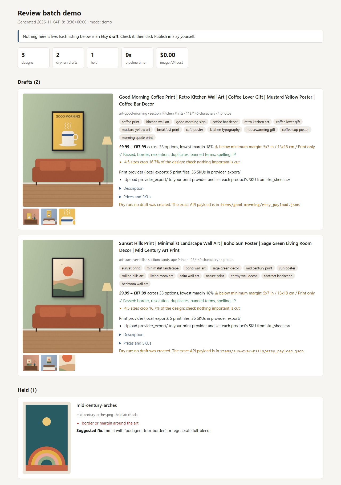
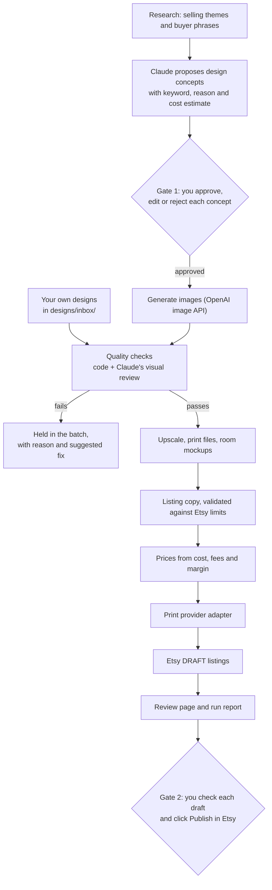
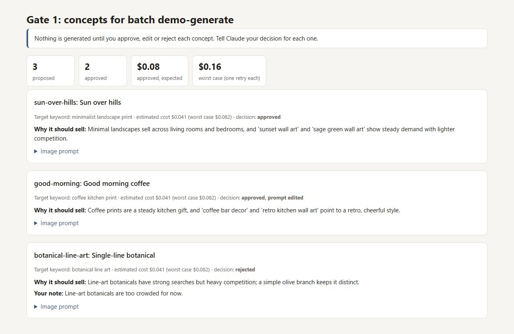

# etsy-pod-agent

[](https://github.com/masonbudd/etsy-pod-agent/actions/workflows/tests.yml)

Claude Code skills and a Python pipeline that turn print-on-demand wall-art designs into
checked Etsy **draft** listings, with room mockups, listing copy, prices, print files and a
review page. A person approves at two points, and the shop owner always clicks Publish.

## The problem

Listing one print-on-demand design on Etsy properly takes a lot of small steps. You check
the art for spelling mistakes, borders and IP problems. You upscale it and crop it for every
print size. You make room mockups and write a title, description and 13 tags within Etsy's
limits. You price every size and frame and set up the files at the print provider. Done by
hand, that adds up to most of an hour per design. Fully automated, mistakes go live. This
project automates the steps, keeps a person at the two points that matter, and holds
anything that fails a check, with the reason.



## How it works



Two ways in: **generate mode** (the top path) researches what sells, proposes concepts and
generates the approved ones; **inbox mode** starts from your own designs in `designs/inbox/`.
From the quality checks onwards, both follow the same path.

**Division of labour.** Python does everything with a right answer: Etsy limits, prices,
image measurements, state, API calls. Claude does the judgement inside the skill: reading
each image for spelling and IP, and writing copy. Claude's output is JSON that code
validates; invalid copy goes back to Claude, and after three failures the item is held.

**Resumable.** Each batch has a `state.json`. Every step skips finished work, so
`podagent run <batch>` is safe to repeat after a crash or a fix. A rerun never creates a
second Etsy draft: the listing ID is saved the moment Etsy returns it. If a run dies between
Etsy's reply and the save, the next run finds the draft by title instead of making another.

## What you need to connect

| | Needed for | Required? |
|---|---|---|
| Claude Code | running the skills | Yes |
| Python 3.11+ | the pipeline | Yes |
| Etsy developer app (OAuth with PKCE) | creating drafts | Yes, except for dry runs and the demo |
| Print provider | fulfilling orders | Yes for selling. `local_export` works with any provider; `prodigi` uses its API ([docs/providers.md](docs/providers.md)) |
| Claude in Chrome extension | ticking Etsy's AI-disclosure box; the browser adapter | Yes for live drafts |
| Real-ESRGAN (`realesrgan-ncnn-vulkan`) | sharper upscaling | Optional; falls back to a plain resize |
| OpenAI API key | generating designs and room templates | Generate mode only |
| Research source (ProfitTree MCP, or a keyword CSV from any tool) | finding themes and buyer phrases | Generate mode only |

`/setup-shop` walks through each one. `podagent doctor` reports what is missing; optional tools
show as `--` and don't count as failures.

Etsy reviews new developer apps before their keys work, so create your app early.

## Quick start

```bash
git clone https://github.com/masonbudd/etsy-pod-agent.git
cd etsy-pod-agent
python -m venv .venv
source .venv/bin/activate        # Windows: .venv\Scripts\activate
pip install -e .
```

Install it editable (`-e`), as above. podagent reads the example config, sample rooms and
demo files from this folder, so a plain `pip install .` isn't enough.

Then, in Claude Code, from the repo folder:

1. `/setup-shop`: creates `config.toml` and `.env`, connects Etsy and your print provider,
   checks every tool, and can generate room templates for your mockups.
2. Either put your own designs (portrait PNG or JPEG) in `designs/inbox/` and run
   `/create-listings 5 inbox`, or run `/create-listings 5 generate` for new designs.
   Generate mode stops after proposing concepts and waits for your decision on each.
3. You get checks, mockups, copy, prices, provider files, Etsy drafts and a review page.

**Run your first batch as a dry run** (`podagent run <batch> --dry-run`). It sends nothing to
Etsy or your print provider and writes the exact Etsy payload for you to read. Then run it for
real, open each draft in Etsy, and check it before you publish.

`podagent status <batch>` shows where every design in a batch is, step by step, with the
reason for anything held.

## Demo mode

No accounts, no network, about 30 seconds:

```bash
podagent demo
```

It runs both modes, each in its own sample workspace:

- **Inbox** (`demo_output/inbox/batches/demo/review.html`): three sample designs. Two become
  dry-run drafts; one is held because it has a cream margin around the art.
- **Generate** (`demo_output/generate/batches/demo-generate/`): sample keyword research
  (one banned phrase is dropped), three concepts, and a Gate 1 page (`concepts.html`) with
  cost estimates. Sample decisions approve one concept, edit and approve another, and reject
  the third. The two approved concepts go through the real OpenAI client code, with the
  network replaced by a replay that returns sample images. Then the same pipeline runs to
  dry-run drafts.

All code steps run for real: research ranking, concept validation and costing, the Gate 1
record, checks, upscaling, print files, mockups, copy validation, pricing, the print-file
export, the exact Etsy API payload, the review page and the report. The judgement steps
(concepts, visual review, copy) replay outputs Claude wrote for these samples
(`samples/recorded/`). The sample keyword numbers are invented. Two sample designs are drawn
in code (`scripts/make_samples.py`); the third is a painted kingfisher with a cream margin
added in code (`samples.add_margin`), so the border check has something to hold. The three
sample rooms ship with their frame calibration; the tests check the calibrator finds the same corners.

## How approval works, and why



- **Gate 1: concepts before images.** Claude proposes concepts, each with its target
  keyword, why it should sell, the prompt and the estimated cost. Nothing is generated
  until you approve, edit or reject each one. This is where taste and spend are decided.
  The code generates approved concepts only, and an approval is cleared if the prompt
  changes afterwards.
- **Gate 2: drafts, never live listings.** The pipeline creates Etsy drafts and a review
  page. Publishing is your click in Etsy. The Etsy client sends only the requests on its
  allow-list (read shop settings, list drafts, create a draft, upload photos, set inventory)
  and refuses `state` anywhere in a request, so the code can't publish even by mistake.
- **Holds instead of guesses.** A design that fails any check (spelling, border, resolution
  at every size, banned or IP terms, near-duplicates, visible defects) is held inside its
  batch with the reason and a suggested fix. It never becomes a draft.
- **Irreversible browser clicks need a yes.** In the browser steps, Claude asks before any
  click that creates, saves or submits something at the provider.
- **Claude Code asks too.** `.claude/settings.json` has ask rules for `podagent decide`,
  `generate`, `rooms-generate` and `rooms-regenerate`, run as `podagent ...` or
  `python -m podagent ...`. Claude Code stops for your yes before it records a Gate 1
  decision or spends money. If you turn permission prompts off, the code's own gates still
  hold: only approved concepts are generated, within the batch budget.

Etsy's API has no field for its AI-disclosure question, so that tick is a browser step. The
description also always carries an AI-disclosure line from your config.

## Costs

- **Etsy:** drafts are free. Etsy charges its listing fee when you publish. Transaction and
  payment-processing fees are built into the prices (`[pricing.fees]` in config).
- **Print provider:** you pay per order. Base costs in config drive the prices.
- **Image generation:** priced per image from `[images.price_usd]` (estimates in the example
  config; check OpenAI's pricing). The Gate 1 page shows each concept's cost and the worst
  case with one retry. Generation stops before a batch passes `images.max_batch_usd`. A
  request is recorded before it is sent and the image is saved the moment it arrives, so a
  rerun never pays twice. A held design is regenerated at most once, with the fix added to
  the prompt, and the regeneration counts against the same budget. A request the API
  refuses (for example a moderation block) is recorded at $0 with the reason; that concept is
  held and the rest carry on. The run report shows the spend.
- **Room templates:** `podagent rooms-generate` prints the cost and spends nothing until you
  add `--confirm`.
- **Real-ESRGAN:** free, runs locally.
- **Claude:** your Claude Code plan. The run report doesn't include it.

## Testing

The pipeline is covered by the demo and by pytest with mocked API responses for Etsy,
Prodigi and the OpenAI Images API, built from their API references. It has not been run
against live Etsy, provider or OpenAI accounts from this repository. GitHub Actions runs a
format and lint check (ruff), a secret scan, the tests and the demo on every push (Ubuntu
and Windows, Python 3.11 and 3.13).

```bash
pip install -e ".[dev]"
pytest
```

The tests cover Etsy's title, tag, SKU and section limits, pricing and margins, cost
estimates and the budget cap, state and resume (no duplicate drafts, no paying twice),
Gate 1 (only approved concepts are generated), regeneration limits, research filtering,
the checks, room calibration and generation, the Etsy, Prodigi and OpenAI request
payloads, and the secret scanner.

## Limitations

- Portrait designs only.
- Etsy attributes used for search filters (colour, room, subject) are not set.
- EU product-safety (GPSR) fields are not set.
- One currency per shop. VAT or sales tax on your own prices is not modelled.
- Prodigi only sees a listing after you publish it, so `podagent provider-link` runs after
  publishing. Its API reference doesn't say how artwork attaches to a mapped variant: check
  one in Prodigi's dashboard before your first sale.
- Without Real-ESRGAN, large prints come from a plain resize and look softer.
- Research from the ProfitTree MCP happens inside Claude Code: Claude saves the results and
  the pipeline reads them. Without it, research comes from a keyword CSV you export from any tool.
- Image costs are estimates from your config, not OpenAI's bill.
- Options you don't offer (such as a frame on a print-only size) are sent to Etsy disabled,
  with quantity 0. Check how they look on your first live draft.
- Generated room templates vary. Calibration rejects ones without a clear grey frame, but
  check each by eye before approving.
- Swap the sample rooms for your own: generate them in `/setup-shop`, or add room
  photos (`rooms/rooms.toml`, then `podagent rooms-calibrate`).

## Background

Generalised from the author's production workflow, which put over 300 prints live and cut listing time from nearly an hour to a few minutes.

## Project layout

```
.claude/skills/        setup-shop and create-listings skills
src/podagent/          pipeline: checks, images, Etsy, providers, review page, report
samples/               sample designs, rooms and recorded Claude outputs for the demo
scripts/               secret scan, sample drawing
tests/                 pytest suite
docs/                  providers, browser adapter, screenshot
```

Contributors: enable the secret-scan hook with `git config core.hooksPath .githooks`.

## License

MIT
